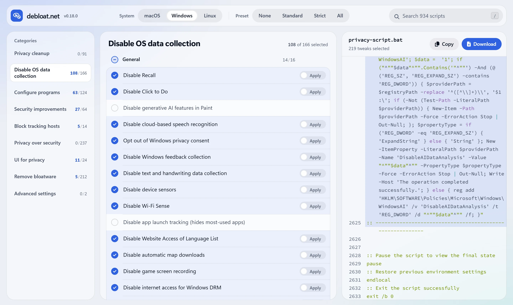
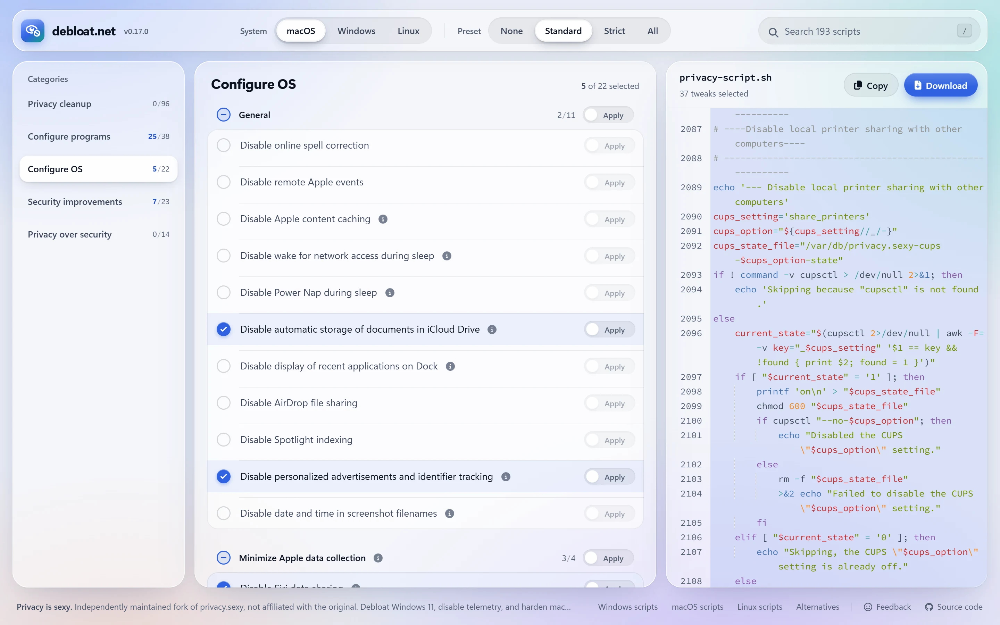
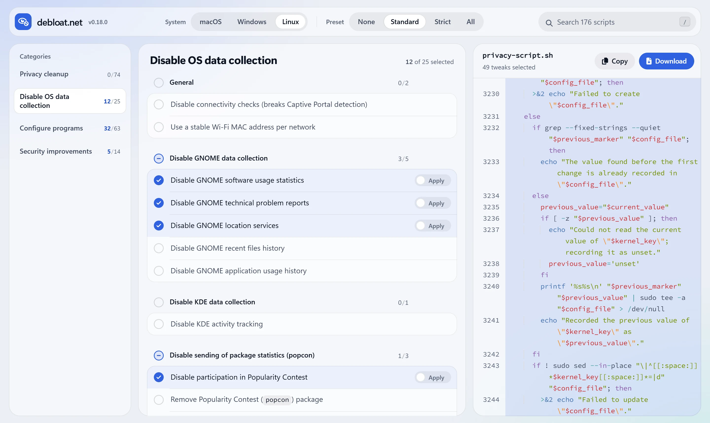

<h1 align="center">
  <a href="https://debloat.net"></a>
  <br>
  debloat.net
</h1>

<p align="center">
  <strong>Debloat Windows 11, turn off telemetry, and harden macOS and Linux.</strong>
  <br>
  Pick the tweaks you want, read what each one does, then download a script and run it yourself.
  <br>
  Free and open source. No account, no install.
</p>

<p align="center">
  <a href="https://debloat.net"><strong>Open debloat.net</strong></a>
  &nbsp;·&nbsp;
  <a href="https://debloat.net/windows/">Windows</a>
  &nbsp;·&nbsp;
  <a href="https://debloat.net/macos/">macOS</a>
  &nbsp;·&nbsp;
  <a href="https://debloat.net/linux/">Linux</a>
  &nbsp;·&nbsp;
  <a href="CHANGELOG.md">Changelog</a>
</p>

<p align="center">
  <a href="https://github.com/Turtlecute33/Debloat.net/releases/latest"></a>
  <a href="LICENSE"></a>
  <a href="https://github.com/undergroundwires/privacy.sexy"></a>
</p>

<a href="https://debloat.net">
  <picture>
    <source media="(prefers-color-scheme: dark)" srcset="img/readme/hero-dark.webp">
    
  </picture>
</a>

## How it works

1. **Choose your system and a preset.** Start from *Standard*, which keeps every app and
   service working, or *Strict* for more privacy. Then add or remove single tweaks.
2. **Read before you run.** Each tweak explains what it changes and what it may break, with
   links to vendor documentation. The script updates live as you choose.
3. **Run it yourself.** Copy or download the script (`.bat` on Windows, `.sh` on macOS and
   Linux) and run it. It asks for administrator rights when it needs them.

The website never runs anything on your computer. Scripts are built in your browser, and your
choices are not sent anywhere.

## What you can change

More than 1,300 tweaks across three systems, each with documentation and sources.

**Windows 11 and Windows 10**: 930+ tweaks

- Turn off telemetry, diagnostic data, the advertising ID, and activity tracking
- Disable Recall, Click to Do, Copilot in Edge, and generative AI in Paint; request removal of
  the Microsoft Copilot app
- Remove bloatware: preinstalled apps, Xbox, OneDrive, Edge, Widgets, and the new Outlook
- Block tracking hosts and clear activity history, caches, and logs
- Harden network protocols, UAC, AutoRun, and Microsoft Defender settings

**macOS**: 190+ tweaks

- Limit Apple data collection, Siri, and personalized ads
- Configure Safari, Firefox, and Brave for privacy
- Tighten the firewall, guest access, sharing, and the login window
- Clear logs, caches, and terminal and app history

**Linux**: 170+ tweaks

- Turn off telemetry in Ubuntu, Debian, Arch Linux, Zorin OS, GNOME, and KDE
- Configure Firefox, Chrome, Brave, and Thunderbird
- Harden the kernel, enable a firewall, and use a private Wi-Fi MAC address per network
- Clear history, caches, and package manager data

<p align="center">
  <picture>
    <source media="(prefers-color-scheme: dark)" srcset="img/readme/macos-dark.webp">
    
  </picture>
  <picture>
    <source media="(prefers-color-scheme: dark)" srcset="img/readme/linux-dark.webp">
    
  </picture>
</p>

## Why debloat.net

- **Nothing hidden.** Every command is on screen before you download it. The script is plain
  text you can read, edit, and share.
- **Explained.** Plain-language notes and source links for every tweak.
- **Reversible.** Most tweaks have a revert option that restores the default.
- **Safe presets.** Tweaks that weaken security, such as turning off Defender or automatic
  updates, are left out of every preset and grouped under *Privacy over security*.
- **Private.** No account, cookies, or ads. The only request beyond the site itself is a
  cookie-free page count to a self-hosted Umami instance.
- **Maintained.** Updated for current releases of Windows 11, macOS, and Linux.

## FAQ

<details>
<summary><strong>Is debloat.net the same as privacy.sexy?</strong></summary>
<br>

debloat.net is an actively maintained fork of
[privacy.sexy](https://github.com/undergroundwires/privacy.sexy), also known as privacy.sexy
Revamped. The original project is no longer maintained. Compared with it, this fork:

- runs only on the web, so there is nothing to install or update;
- adds current Windows controls such as Recall, Click to Do, and Copilot;
- removes outdated tweaks, retired tools such as `wmic`, and advice that traded away security;
- applies per-user changes to your own home folder when a macOS or Linux script runs with `sudo`;
- is covered by regression tests for the script catalog and its safety rules.

It is independent and not affiliated with the original maintainer.

</details>

<details>
<summary><strong>Is it safe to run these scripts?</strong></summary>
<br>

The scripts change system settings, so read the notes of each tweak, start with the *Standard*
preset, and keep a backup or restore point. A setting that suits one computer can break a
feature someone else needs. No script can guarantee privacy, security, or anonymity: the final
decision is yours.

</details>

<details>
<summary><strong>How do I debloat Windows 11?</strong></summary>
<br>

Open [debloat.net](https://debloat.net), select **Windows**, and apply the **Standard** preset.
Add what you want from *Remove bloatware*, review the script, then download it and run it.
It asks for administrator rights.

</details>

<details>
<summary><strong>Can I undo the changes?</strong></summary>
<br>

Most tweaks have a revert option. Turn it on and the script restores the default setting
instead of applying the tweak. Cleanup tweaks, such as clearing history or caches, cannot be
undone.

</details>

## Why this fork exists

I'm [Turtlecute](https://github.com/Turtlecute33), a privacy and security activist.
privacy.sexy made operating-system hardening understandable and open to inspection, and it
deserved to keep working. I revived it to keep its scripts current, remove risky advice, and
check them against vendor documentation as Windows, macOS, and Linux change.

I use AI assistance for code, script research, and documentation. I review its output against
vendor documentation and the test suite before merging, most of all in the script catalog, where
a wrong claim can break someone's computer.

## Contributing

Bug reports, script research, and pull requests are welcome.

- Report a broken tweak or suggest a new one in
  [issues](https://github.com/Turtlecute33/Debloat.net/issues/new/choose).
- Read [CONTRIBUTING.md](CONTRIBUTING.md) and the [script guidelines](docs/script-guidelines.md)
  before opening a pull request.
- Report vulnerabilities privately, as described in the [security policy](SECURITY.md).

To run the site locally, use Node.js:

```sh
npm install
npm run dev
```

More commands are in [docs/development.md](docs/development.md).

## Credits and license

debloat.net is built on [privacy.sexy](https://github.com/undergroundwires/privacy.sexy) by
undergroundwires and its contributors, who created the architecture and script library this
project continues.

Licensed under the [GNU Affero General Public License v3.0](LICENSE), like the original.
